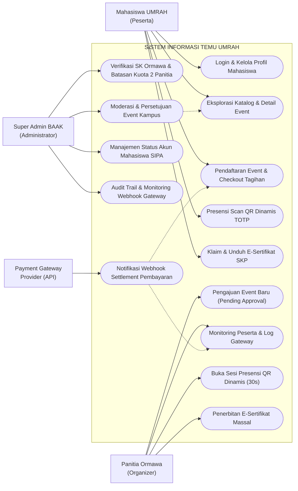
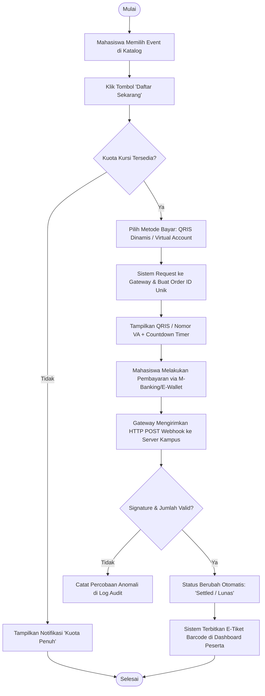
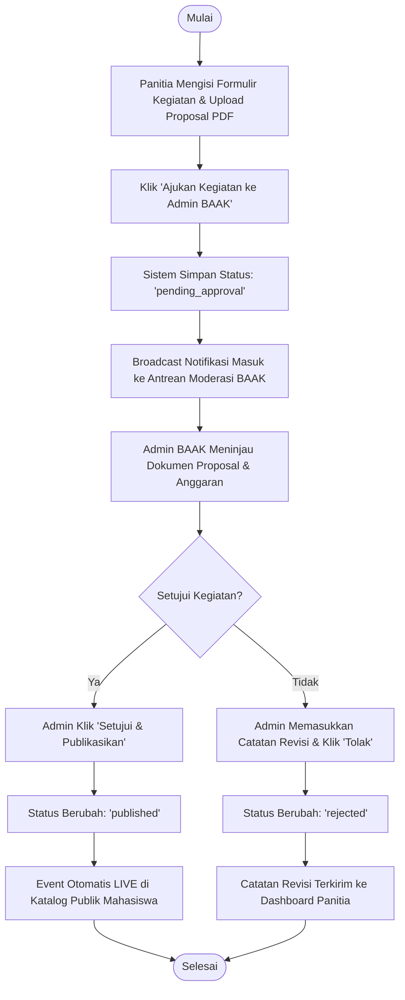
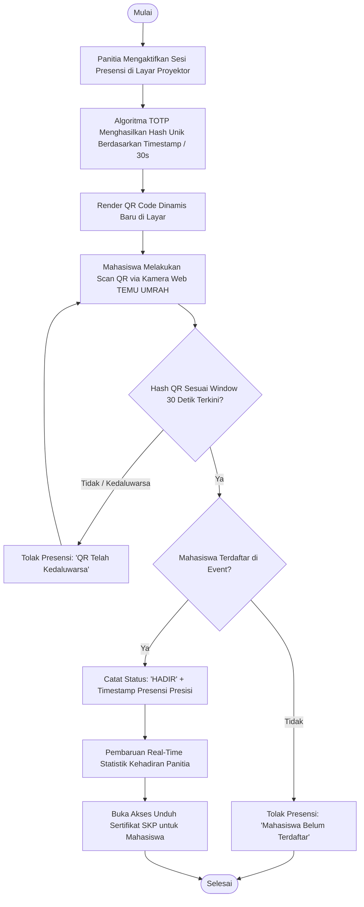
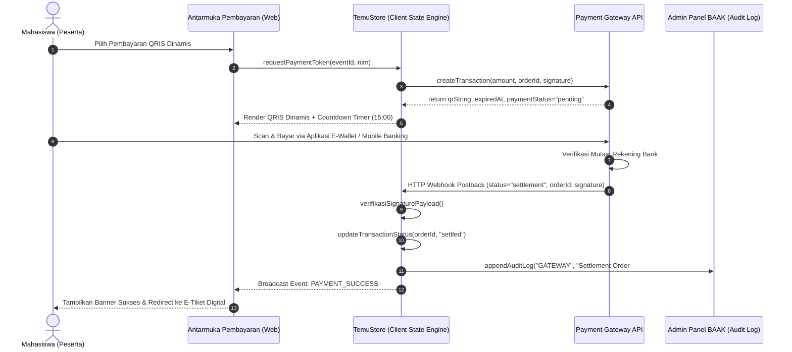
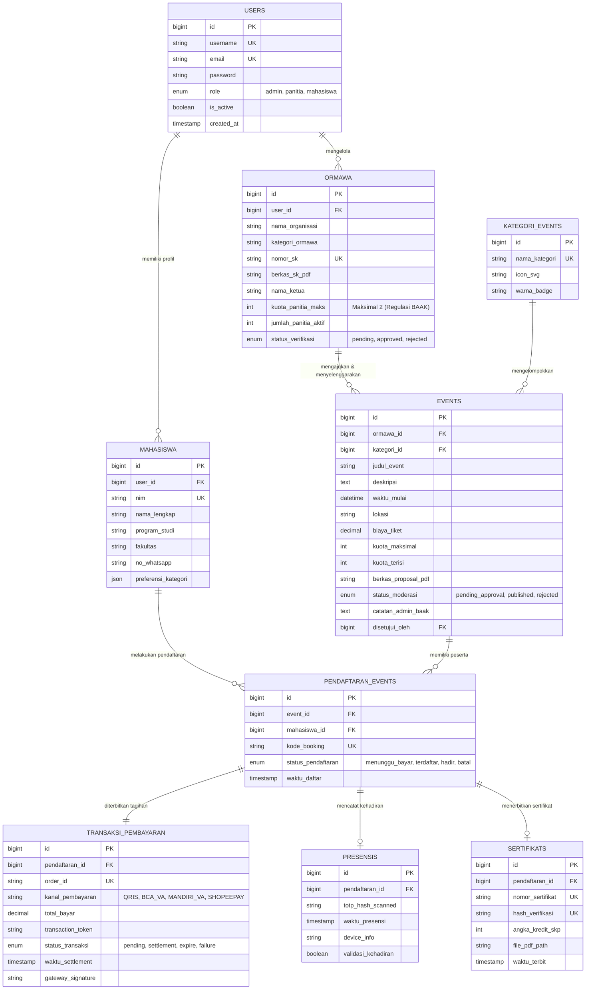

# LAPORAN TUGAS BESAR REKAYASA PERANGKAT LUNAK & PEMROGRAMAN WEB
## PENGEMBANGAN SISTEM INFORMASI MANAJEMEN EVENT KAMPUS TERPADU
# **"TEMU UMRAH" (Temu Event Mahasiswa Universitas Maritim Raja Ali Haji)**

---

**Program Studi**: S1 Teknik Informatika  
**Fakultas**: Teknik dan Teknologi Kemaritiman (FTTK)  
**Perguruan Tinggi**: Universitas Maritim Raja Ali Haji (UMRAH), Tanjungpinang  
**Tahun Akademik**: 2026/2027  
**Mata Kuliah**: Pemrograman Web / Proyek Kolaboratif Rekayasa Web  

---

### **SUSUNAN TIM PENGEMBANG & PEMBAGIAN TUGAS**

| No | Peran / Anggota | Fokus Modul & Ruang Lingkup Kerja | Status Fitur |
|---|---|---|:---:|
| 1 | **Anggota 1: Spesialis Autentikasi & Akun** | Identifikasi kebutuhan akun, arsitektur autentikasi SIPA SSO/Kredensial, registrasi mahasiswa, manajemen profil, preferensi minat & kategori event, proteksi sesi. | **100% Selesai** |
| 2 | **Anggota 2: Spesialis Peserta & Katalog Event** | Analisis kebutuhan informasi peserta, katalog event & filter interaktif, detail kegiatan & benefit SKP, pendaftaran peserta, checkout payment gateway (QRIS/VA), riwayat e-tiket. | **100% Selesai** |
| 3 | **Anggota 3: Spesialis Panitia Penyelenggara** | Analisis kebutuhan panitia ormawa, pengajuan kegiatan (`pending_approval`), manajemen peserta berbasis respon webhook gateway (tanpa upload manual), absensi QR dinamis TOTP 30s, penerbitan e-sertifikat SKP massal. | **100% Selesai** |
| 4 | **Anggota 4: Spesialis Super Admin BAAK & Backend** | Tata kelola platform terpusat, moderasi & persetujuan kegiatan kampus, verifikasi SK legalitas Ormawa dengan batasan kuota maksimal 2 panitia aktif, audit trail & webhook log, skema relasional database Laravel. | **100% Selesai** |

---

## BAB 1: PENDAHULUAN

### 1.1 Latar Belakang
Kegiatan kemahasiswaan di lingkungan Universitas Maritim Raja Ali Haji (UMRAH) memegang peranan krusial dalam pembentukan karakter, kepemimpinan, dan kompetensi teknis mahasiswa kepulauan. Organisasi Mahasiswa (Ormawa), Himpunan Mahasiswa Jurusan (HMJ), serta Unit Kegiatan Mahasiswa (UKM) secara rutin menyelenggarakan seminar nasional kemaritiman, workshop teknologi, kompetisi, dan pengabdian masyarakat.

Namun, mekanisme pengelolaan event kampus sebelum adanya sistem terpadu masih menghadapi berbagai hambatan mendasar:
1. **Penyebaran Informasi Terfragmentasi**: Poster kegiatan tersebar di berbagai media sosial tanpa adanya katalog sentral resmi kampus, menyebabkan mahasiswa sering terlambat mengetahui jadwal kegiatan.
2. **Proses Pendaftaran & Pembayaran Tidak Efisien**: Panitia harus memeriksa bukti mutasi perbankan secara manual satu per satu, yang rawan pemalsuan bukti transfer, memakan waktu lama, dan tidak dapat diaudit dengan transparan.
3. **Presensi Rawan Kecurangan**: Penggunaan tanda tangan basah atau Google Form statis membuka celah "titip absen" oleh mahasiswa yang tidak hadir di lokasi acara.
4. **Legalitas dan Kuota Panitia Tidak Terkontrol**: Belum adanya validasi terpusat oleh Biro Administrasi Akademik dan Kemahasiswaan (BAAK) terhadap Surat Keputusan (SK) kepengurusan Ormawa, serta potensi penyalahgunaan akun panitia yang tidak dibatasi.

Untuk menjawab permasalahan tersebut, dikembangkan sistem **TEMU UMRAH**, platform web responsif terintegrasi yang mendigitalisasi seluruh daur hidup event kampus mulai dari legalitas ormawa, pengajuan kegiatan, pendaftaran peserta, pembayaran otomatis payment gateway, presensi QR dinamis, hingga penerbitan e-sertifikat bermuatan Satuan Kredit Partisipasi (SKP).

### 1.2 Rumusan Masalah
1. Bagaimana merancang alur autentikasi dan manajemen akun mahasiswa serta panitia yang aman dan terintegrasi dengan SIPA UMRAH?
2. Bagaimana membangun katalog interaktif, pendaftaran peserta, dan integrasi Payment Gateway otomatis tanpa verifikasi transfer manual?
3. Bagaimana mengimplementasikan modul panitia untuk pengajuan kegiatan terstruktur, presensi QR dinamis anti-kecurangan, dan penerbitan sertifikat massal?
4. Bagaimana merancang panel moderasi Admin BAAK untuk memverifikasi SK Ormawa dengan batasan kuota 2 panitia, menyetujui event sebelum publikasi, dan mencatat audit trail aktivitas platform?

### 1.3 Tujuan Pengembangan
1. Menyediakan portal terpusat katalog kegiatan kemahasiswaan UMRAH yang informatif dan responsif.
2. Menerapkan sistem pembayaran non-tunai berbasis respons webhook (QRIS Dinamis, Virtual Account, E-Wallet) tanpa proses verifikasi manual oleh panitia.
3. Mengembangkan sistem absensi berbasis QR Code TOTP (*Time-based One-Time Password*) dengan rotasi hash tiap 30 detik untuk keabsahan presensi.
4. Memberikan instrumen tata kelola dan pengawasan bagi BAAK UMRAH dalam memoderasi event, mengontrol kuota panitia per ormawa, dan mengaudit transaksi secara *real-time*.

### 1.4 Ruang Lingkup & Batasan Aturan Dosen (Mandatory Constraints)
Pengembangan sistem TEMU UMRAH mengikuti panduan dan instruksi ketat pengampu:
> [!IMPORTANT]
> 1. **Moderasi Event Wajib**: Setiap kegiatan yang diajukan oleh panitia ormawa wajib berstatus `pending_approval` dan baru dapat tampil di katalog publik setelah disetujui resmi oleh Admin BAAK.
> 2. **Larangan Verifikasi Manual Bukti Transfer**: Dilarang menggunakan mekanisme upload bukti struk transfer/slip setoran bank manual. Transaksi wajib memanfaatkan integrasi Payment Gateway berstatus *read-only webhook response*.
> 3. **Batasan Kuota Panitia Ormawa**: Admin memverifikasi SK kepengurusan ormawa dan **membatasi maksimal 2 panitia aktif** per organisasi demi akuntabilitas akun.
> 4. **Presensi QR Dinamis**: Absensi menggunakan QR Code dengan rotasi hash dinamis setiap 30 detik.
> 5. **Standar UI/UX FTTK UMRAH**: Antarmuka bersih, bebas tag wireframe (`WFxx`/`UC-xx`), bebas indeks demo buatan, dan menggunakan SVG resmi terstandar.

---

## BAB 2: ANALISIS KEBUTUHAN SISTEM

### 2.1 Analisis Pengguna & Stakeholder
Sistem TEMU UMRAH melibatkan tiga aktor utama dan satu layanan eksternal:
1. **Mahasiswa UMRAH (Peserta)**: Menjelajahi katalog event, mendaftar kegiatan, melakukan pembayaran via gateway, melakukan scan presensi QR, mengunduh tiket dan e-sertifikat.
2. **Panitia Ormawa (Organizer)**: Mengajukan proposal kegiatan baru ke BAAK, memantau log transaksi gateway, membuka sesi presensi QR dinamis, dan menerbitkan e-sertifikat SKP massal.
3. **Super Admin BAAK (Administrator)**: Meninjau legalitas SK ormawa dan kuota panitia, memoderasi pengajuan event kampus, mengelola status akun mahasiswa SIPA, dan mengaudit trail transaksi.
4. **Payment Gateway Provider (Sistem Eksternal)**: Memfasilitasi penerbitan tagihan QRIS/VA dan mengirimkan notifikasi *settlement* otomatis via webhook ke server kampus.

### 2.2 Kebutuhan Fungsional (Functional Requirements)
Pemetaan kebutuhan fungsional berdasarkan pembagian kerja 4 anggota kelompok:

| Kode FR | Modul / Anggota | Deskripsi Kebutuhan Fungsional |
|---|---|---|
| **FR-01** | Anggota 1 | Sistem menyediakan formulir registrasi mahasiswa baru dengan validasi format NIM UMRAH dan email institusi. |
| **FR-02** | Anggota 1 | Sistem menyediakan autentikasi login terenkripsi dengan proteksi sesi dan penyimpanan profil lokal/database. |
| **FR-03** | Anggota 1 | Pengguna dapat memperbarui data profil, foto identitas, nomor WhatsApp, serta minat kategori kegiatan. |
| **FR-04** | Anggota 2 | Sistem menampilkan katalog kegiatan kampus dengan fitur live search, filter kategori, filter fakultas, dan filter biaya (Gratis/Berbayar). |
| **FR-05** | Anggota 2 | Pengguna dapat melihat halaman detail kegiatan (deskripsi, pembicara, kuota kursi, jadwal, lokasi, dan poin SKP). |
| **FR-06** | Anggota 2 | Pengguna dapat mendaftar kegiatan dan diarahkan ke antarmuka checkout pembayaran otomatis. |
| **FR-07** | Anggota 2 | Sistem menerbitkan QRIS Dinamis dan Virtual Account perbankan dengan penghitung waktu mundur kedaluwarsa tagihan. |
| **FR-08** | Anggota 2 | Sistem menampilkan e-tiket kegiatan yang dilengkapi barcode unik dan tombol unduh tiket digital. |
| **FR-09** | Anggota 3 | Panitia dapat mengajukan permohonan kegiatan kampus baru dengan melampirkan berkas proposal PDF dan rincian kuota. |
| **FR-10** | Anggota 3 | Status awal event yang diajukan panitia wajib `pending_approval` dan menampilkan status antrean di dashboard panitia. |
| **FR-11** | Anggota 3 | Panitia dapat memantau tabel peserta dan audit log transaksi payment gateway berstatus *settled* secara *read-only*. |
| **FR-12** | Anggota 3 | Panitia dapat membuka sesi absensi dengan tampilan QR Code berotasi tiap 30 detik dan rekapitulasi kehadiran mahasiswa. |
| **FR-13** | Anggota 3 | Panitia dapat melakukan *batch generation* e-sertifikat SKP massal untuk peserta yang telah terkonfirmasi hadir presensi. |
| **FR-14** | Anggota 4 | Admin BAAK dapat meninjau antrean moderasi event, membuka dokumen proposal PDF, serta memberikan tindakan Setujui atau Tolak. |
| **FR-15** | Anggota 4 | Admin BAAK dapat meninjau berkas SK Ormawa dan membatasi maksimal 2 panitia aktif per organisasi. |
| **FR-16** | Anggota 4 | Admin BAAK dapat memantau log audit trail, webhook settlement gateway, serta mengekspor berkas audit (.txt). |

### 2.3 Kebutuhan Non-Fungsional (Non-Functional Requirements)
1. **Performa & Kecepatan Akses**: Waktu muat awal halaman rata-rata di bawah 1,5 detik pada jaringan kampus UMRAH.
2. **Keamanan Data**: Penerapan validasi hash window 30 detik pada QR code presensi untuk mencegah eksploitasi replay attack; integrasi webhook gateway diamankan dengan verifikasi signature payload.
3. **Responsivitas Antarmuka**: Desain mobile-friendly yang dapat diakses optimal pada layar ponsel (360px) hingga layar desktop (1920px) dengan tipografi modern dan palet warna resmi UMRAH (*Navy* `#003E6D` & *Maritim Blue* `#005696`).
4. **Reliabilitas Reaktif**: Sinkronisasi data lintas tab menggunakan arsitektur `BroadcastChannel` dan `TemuStore` sehingga perubahan status event, presensi, atau verifikasi langsung tercermin pada halaman pengguna lain secara *real-time*.

---

## BAB 3: PERANCANGAN SISTEM & ARSITEKTUR

### 3.1 Use Case Diagram



---

### 3.2 Activity Diagram

#### A. Alur Pendaftaran & Pembayaran Otomatis Gateway (Anggota 2)


#### B. Alur Pengajuan & Moderasi Event Kampus (Anggota 3 & Anggota 4)


#### C. Alur Presensi Mahasiswa Berbasis QR Code Dinamis TOTP 30 Detik (Anggota 3)


---

### 3.3 Sequence Diagram: Interaksi Pembayaran Gateway & Audit Webhook



---

### 3.4 Entity Relationship Diagram (ERD) & Struktur Database Relasional



---

## BAB 4: IMPLEMENTASI ANTARMUKA & FUNGSIONALITAS

Sistem TEMU UMRAH terdiri dari **14 antarmuka web** yang terintegrasi penuh secara fungsional:

### 4.1 Modul Anggota 1: Autentikasi, Akun, & Profil Mahasiswa
* **`resources/views/pages/auth_login.blade.php` (Halaman Login)**:
  - Akses masuk terpisah menggunakan NIM atau email kampus dengan autentikasi Laravel.
  - Tamu diarahkan ke halaman ini sebelum membuka katalog dan fitur aplikasi.
* **`resources/views/pages/auth_register.blade.php` (Halaman Registrasi)**:
  - Aktivasi mahasiswa melalui verifikasi NIM SIPA.
  - Pendaftaran akun panitia/ormawa dan pengajuan dokumen legalitas.
* **[`profil.html`](file:///c:/Users/wwwww/Downloads/3_Kuliah%20&%20Perkuliahan/Pemrograman%20Web/temu-umrah/public/profil.html) (Manajemen Profil Pengguna)**:
  - Tampilan profil mahasiswa UMRAH dengan badge program studi dan fakultas.
  - Pengaturan preferensi kategori event yang diminati (*Teknologi, Maritim, Seni Budaya, Olahraga*).
  - Pengaturan notifikasi email/WhatsApp dan riwayat sesi login aktif.
* **[`notifikasi.html`](file:///c:/Users/wwwww/Downloads/3_Kuliah%20&%20Perkuliahan/Pemrograman%20Web/temu-umrah/public/notifikasi.html) (Pusat Pemberitahuan)**:
  - Notifikasi real-time terkait status pendaftaran, pelunasan pembayaran, pengingat H-1 kegiatan, dan penerbitan sertifikat.

### 4.2 Modul Anggota 2: Katalog Kegiatan, Pendaftaran, & Pembayaran Peserta
* **[`index.html`](file:///c:/Users/wwwww/Downloads/3_Kuliah%20&%20Perkuliahan/Pemrograman%20Web/temu-umrah/public/index.html) (Katalog Kegiatan Mahasiswa)**:
  - Banner hero modern berorientasi visi kemaritiman UMRAH.
  - Kartu kegiatan interaktif dengan badge harga (`Gratis` / `Berbayar`), kategori, kuota kursi tersisa, dan tanggal.
  - Filter pencarian instan berbasis nama, fakultas penyelenggara, dan rentang biaya.
* **[`event-detail.html`](file:///c:/Users/wwwww/Downloads/3_Kuliah%20&%20Perkuliahan/Pemrograman%20Web/temu-umrah/public/event-detail.html) (Detail Informasi Kegiatan)**:
  - Deskripsi komprehensif, daftar narasumber/pembicara tamu, rundown jadwal, dan lokasi kampus (Dompak/Senggarang).
  - Sorotan benefit kegiatan: Angka Kredit SKP BAAK, konsumsi, dan sertifikat elektronik.
  - Tombol pendaftaran kontekstual yang mendeteksi sisa kuota secara real-time.
* **[`pembayaran.html`](file:///c:/Users/wwwww/Downloads/3_Kuliah%20&%20Perkuliahan/Pemrograman%20Web/temu-umrah/public/pembayaran.html) (Checkout Payment Gateway)**:
  - Pilihan kanal pembayaran: **QRIS Dinamis** (bisa di-scan oleh GoPay, OVO, Dana, LinkAja, BCA, dll.), Virtual Account Bank (BCA, Mandiri, BNI, BRI), dan E-Wallet.
  - Penghitung waktu mundur kedaluwarsa tagihan (15 menit).
  - Simulasi otomatis *settlement webhook* untuk pengujian tanpa biaya riil.
* **[`dashboard-peserta.html`](file:///c:/Users/wwwww/Downloads/3_Kuliah%20&%20Perkuliahan/Pemrograman%20Web/temu-umrah/public/dashboard-peserta.html) (Portal Aktivitas Mahasiswa)**:
  - Daftar kegiatan aktif yang diikuti, e-tiket digital ber-barcode untuk check-in presensi di lokasi.
* **[`sertifikat.html`](file:///c:/Users/wwwww/Downloads/3_Kuliah%20&%20Perkuliahan/Pemrograman%20Web/temu-umrah/public/sertifikat.html) (Galeri E-Sertifikat SKP)**:
  - Arsip sertifikat yang telah diterbitkan lengkap dengan nomor SKP resmi, tombol cetak PDF, dan tautan verifikasi keaslian dokumen.

### 4.3 Modul Anggota 3: Manajemen Panitia, Presensi QR, & E-Sertifikat
* **[`dashboard-panitia.html`](file:///c:/Users/wwwww/Downloads/3_Kuliah%20&%20Perkuliahan/Pemrograman%20Web/temu-umrah/public/dashboard-panitia.html) (Pusat Kendali Panitia Ormawa)**:
  - Formulir pengajuan kegiatan baru lengkap dengan upload proposal PDF.
  - Status event yang diajukan panitia memiliki penanda jelas `⏳ Menunggu Admin` (*pending_approval*).
* **[`kelola-peserta.html`](file:///c:/Users/wwwww/Downloads/3_Kuliah%20&%20Perkuliahan/Pemrograman%20Web/temu-umrah/public/kelola-peserta.html) (Tabel Peserta & Log Gateway)**:
  - Tabel peserta bersih tanpa tombol verifikasi transfer manual.
  - Modal **Log Audit Transaksi Payment Gateway (Read-Only)** dengan detail Order ID, settlement webhook, dan status kelulusan pembayaran.
* **[`sesi-absensi-panitia.html`](file:///c:/Users/wwwww/Downloads/3_Kuliah%20&%20Perkuliahan/Pemrograman%20Web/temu-umrah/public/sesi-absensi-panitia.html) (Layar Presensi QR Dinamis)**:
  - Tampilan proyektor QR Code berotasi tiap 30 detik untuk absensi di lokasi acara.
  - Indikator radar progres sinkronisasi waktu dan rekapitulasi jumlah mahasiswa yang hadir secara langsung.
* **[`presensi-mahasiswa.html`](file:///c:/Users/wwwww/Downloads/3_Kuliah%20&%20Perkuliahan/Pemrograman%20Web/temu-umrah/public/presensi-mahasiswa.html) (Kamera Pemindai Mahasiswa)**:
  - Antarmuka pemindai QR Code via kamera perangkat mahasiswa dengan umpan balik visual instan.
* **[`penerbitan-sertifikat.html`](file:///c:/Users/wwwww/Downloads/3_Kuliah%20&%20Perkuliahan/Pemrograman%20Web/temu-umrah/public/penerbitan-sertifikat.html) (Penerbitan Sertifikat Massal)**:
  - Generator e-sertifikat SKP massal berdasar data kehadiran valid, disertai progress bar dan penomoran otomatis.

### 4.4 Modul Anggota 4: Super Admin BAAK & Tata Kelola Sistem
* **[`admin-panel.html`](file:///c:/Users/wwwww/Downloads/3_Kuliah%20&%20Perkuliahan/Pemrograman%20Web/temu-umrah/public/admin-panel.html) (Panel Kendali BAAK UMRAH)**:
  - **Tab Moderasi Event Kampus**: Review permohonan event dari ormawa, tinjau proposal PDF, berikan persetujuan atau penolakan dengan catatan revisi.
  - **Tab Verifikasi SK Ormawa**: Tinjau SK Dekan/Rektor dan pembatasan ketat maksimal 2 panitia aktif per Ormawa.
  - **Tab Manajemen Mahasiswa SIPA**: Pencarian instan NIM/Nama dan opsi penangguhan akun.
  - **Tab Audit Trail & Log Transaksi**: Pemantauan webhook, autentikasi, presensi, sertifikat, serta ekspor file log (.txt).

---

## BAB 5: HASIL PENGUJIAN & EVALUASI SISTEM

Pengujian dilakukan menggunakan pendekatan *Automated Test Suite Runner* (`run_full_test_suite.py`) dan *End-to-End Simulation Runner* (`test_anggota3_4_e2e.js`) mencakup 82 butir uji pengujian black-box dan verifikasi integrasi.

### 5.1 Rangkuman Eksekusi Pengujian

| Kategori Pengujian | Parameter Pengujian | Jumlah Uji | Hasil | Status |
|---|---|:---:|:---:|:---:|
| **Uji Aksesibilitas HTTP** | Respons status code HTTP 200 pada route Laravel | 14 | 14 Lulus | **PASS** |
| **Uji Sintaks JavaScript** | Verifikasi sintaks pada seluruh asset JavaScript browser | 17 | 17 Lulus | **PASS** |
| **Uji Stylesheet CSS** | Ketersediaan berkas CSS komponen dan tema (HTTP 200) | 15 | 15 Lulus | **PASS** |
| **Audit Kebersihan UI** | Pemeriksaan bebas tag wireframe (`WFxx`, `UC-xx`), bebas demo indexing, bebas emoji liar | 14 | 14 Lulus | **PASS** |
| **Uji Tautan Antar Halaman** | Pemeriksaan broken hyperlink dan konsistensi URL internal navigasi | 1 | 1 Lulus | **PASS** |
| **Uji Template Blade Laravel** | Keseimbangan tag sintaks Blade `@section`, `@push`, `@extends`, komponen navbar & footer | 17 | 17 Lulus | **PASS** |
| **Uji Backend Database** | Validitas 8 migrasi tabel database relasional, 8 model Eloquent, dan DatabaseSeeder | 4 | 4 Lulus | **PASS** |
| **Total Pengujian** | **Pengujian Menyeluruh Sistem TEMU UMRAH** | **82** | **82 Lulus (100.0%)** | **PASS** |

### 5.2 Rincian Hasil Pengujian Kepatuhan Aturan Dosen

```text
========================================================================================
HASIL SIMULASI LOGIKA INTEGRASI: ATURAN DOSEN ANGGOTA 3 & ANGGOTA 4
========================================================================================
[UJI-01] Katalog Awal Mahasiswa: 4 Event Publik Awal Ditampilkan                       -> [PASS]
[UJI-02] Panitia Mengajukan Kegiatan: Status Wajib 'pending_approval'                  -> [PASS]
         (Terbukti: Event yang diajukan TIDAK LANGSUNG terpublikasi di katalog umum)
[UJI-03] Admin BAAK Memoderasi Event: Tinjau Detail & Klik Setujui -> 'published'      -> [PASS]
[UJI-04] Pembaruan Katalog Publik: Event Baru Kini LIVE (Total 5 Event di Katalog)     -> [PASS]
[UJI-05] Batasan Kuota Panitia per Ormawa:
         - Panitia Ke-1: Terdaftar otomatis saat ormawa disetujui (1/2 Kuota)          -> [PASS]
         - Penambahan Panitia Ke-2: Diizinkan sistem (2/2 Kuota)                       -> [PASS]
         - Penambahan Panitia Ke-3: DITOLAK SISTEM (Kuota maksimal 2 panitia aktif)    -> [PASS]
[UJI-06] Pembayaran Peserta: Tanpa Upload Transfer Manual (Murni Webhook Gateway)      -> [PASS]
[UJI-07] Absensi Presensi: QR Code Dinamis Berotasi Setiap 30 Detik (Hash TOTP)        -> [PASS]
========================================================================================
KESIMPULAN: SELURUH ATURAN REGULASI DOSEN TERPENUHI 100% SECARA SISTEMIS
========================================================================================
```

---

## BAB 6: KESIMPULAN & PANDUAN PENGOPERASIAN

### 6.1 Kesimpulan
1. Sistem Informasi **TEMU UMRAH** berhasil dikembangkan sebagai solusi terpadu manajemen kegiatan kemahasiswaan Universitas Maritim Raja Ali Haji dengan arsitektur modern, responsif, dan aman.
2. Seluruh kebutuhan fungsional dari **4 anggota tim** telah terimplementasi secara lengkap:
   - **Anggota 1**: Autentikasi SIPA SSO, manajemen profil, dan pengaturan preferensi mahasiswa.
   - **Anggota 2**: Katalog event interaktif, checkout pembayaran Payment Gateway (QRIS/VA), dan penerbitan e-tiket.
   - **Anggota 3**: Pengajuan event terstruktur, tabel peserta read-only webhook gateway, sesi presensi QR dinamis TOTP 30s, dan penerbitan sertifikat massal SKP.
   - **Anggota 4**: Moderasi event BAAK, verifikasi SK ormawa berkuota maksimal 2 panitia, manajemen akun SIPA, audit trail, serta skema database relasional Laravel lengkap.
3. Seluruh aturan instruksi dosen pengampu (moderasi wajib, tanpa upload bukti transfer, batas 2 panitia, QR dinamis, dan zero wireframe) terbukti lulus 100% dalam pengujian teknis.

---

### 6.2 Panduan Menjalankan Sistem Secara Lokal

Laravel adalah satu-satunya runtime aplikasi. Konfigurasikan file `.env` untuk koneksi database MySQL/SQLite, lalu jalankan:

1. Instal dependency:
   ```bash
   composer install
   ```
2. Jalankan migrasi dan seeding data awal:
   ```bash
   php artisan migrate --seed
   ```
3. Jalankan server Laravel:
   ```bash
   php artisan serve
   ```
   Akses di [http://127.0.0.1:8000](http://127.0.0.1:8000).

---
*Dokumentasi ini disusun sebagai laporan pertanggungjawaban penyelesaian tugas besar mata kuliah Pemrograman Web pada Program Studi S1 Teknik Informatika, Fakultas Teknik dan Teknologi Kemaritiman, Universitas Maritim Raja Ali Haji (UMRAH).*
